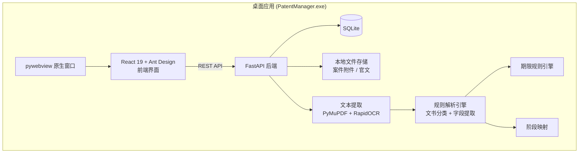
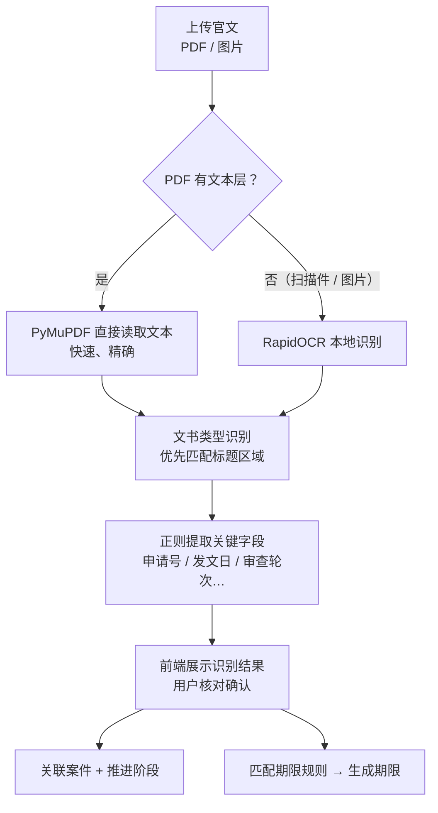

# 专利案件全生命周期管理系统

> 一款面向专利代理人和企业知识产权管理的 **Windows 桌面应用**，覆盖专利从交底书、撰写、提交、审查到授权、结案的全过程。上传国知局官方文书后，系统会自动识别文书类型、提取关键信息、推进案件阶段并计算答复期限。**全部数据只在本地处理，不依赖任何云服务。**


---

## 项目背景

专利代理工作中，一件专利从申请到授权往往要经历受理、初审、多轮审查意见答复、补正、复审等环节，每个环节都有严格的法定期限。一旦错过期限，专利可能被**视为撤回**或丧失权利。

传统做法依赖人工阅读官文、手动登记期限、在 Excel 中追踪案件状态，效率低而且容易出错。本项目把这条流程自动化：

**上传官文 → 自动识别 → 人工确认 → 案件阶段推进 + 期限生成 → 看板集中提醒**

## 核心功能

| 模块 | 说明 |
| --- | --- |
| 📊 **期限看板** | 集中展示所有案件的待处理、已完成、已超期期限，按到期日排序，临近期限一目了然 |
| 🏢 **企业管理** | 以客户企业为核心组织案件：企业下挂全部案件，查看各阶段分布与待处理期限；录入官文时按申请人自动建企业 |
| 📁 **案件管理** | 案件新建、编辑、确认、删除；按专利类型显示流程进度；完整保留阶段变更历史；**一案双申**（同日发明 + 实用新型）自动关联 |
| 📂 **文件夹批量录入** | 选择一个文件夹即可导入其中全部官文；按申请号归入已有案件，受理通知书等匹配不到的自动建案；按发文日顺序保存 |
| 📤 **官文智能识别** | 上传 PDF 或图片格式的官文，自动识别 **18 类**国知局官方文书（另含交底书、其他），提取申请号、申请日、发文日、发文序号、申请人、专利名称等字段 |
| 🔁 **重复官文拦截** | 按文件内容、发文序号、申请号 + 文书类型 + 发文日三重比对，同一份通知书不会被重复录入 |
| 👥 **代理人名单** | 维护代理人名单（执业 / 实习 / 助理、技术领域、执业证号选填），案件承办人从名单中选择，同名同姓可区分 |
| ⏱️ **期限规则引擎** | 可配置的期限规则，按「文书类型 × 审查轮次 × 专利类型」匹配，自动计算答复截止日 |
| 🔄 **阶段自动流转** | 案件阶段由已上传的通知书决定（共 **20 个阶段**）：取发文日最晚的通知书，同日按流程先后；与上传顺序无关。审查意见按「第 N 次」区分一审、二审、三审及以后，支持任意轮次 |
| 📎 **附件归档** | 交底材料、CAD 图纸、答复文件等按案件分文件夹存储，可在资源管理器中一键打开 |
| ⚙️ **数据目录设置** | 可自定义数据存放位置，方便备份和迁移 |
| 🧭 **新人引导** | 首次打开自动分步引导，「使用指南」页可随时回看 |

## 系统架构



### 官文处理流程



## 技术亮点

### 1. 混合式文本提取：文本层优先，OCR 兜底
逐页检查 PDF 是否有可用的文本层（每页至少 20 个字符）。有文本层的页面直接用 PyMuPDF 读取，速度快且零误差；扫描件或图片则自动切换到 **RapidOCR（ONNX Runtime）** 本地识别。整个过程不调用任何云端接口，保证客户案件信息不外泄。

### 2. 抗干扰的文书分类
官文正文中经常出现其他文书的名称，例如驳回决定会引用此前的「审查意见通知书」，几乎所有通知书都有「将被视为撤回」这类格式化提醒。为此设计了两条策略：
- **按确定性排序匹配**：先匹配驳回决定、无效决定等终局类文书，再匹配程序性通知；
- **限定标题区域**：只在文档开头的标题区域查找关键词，并使用完整标题短语（如「视为撤回通知书」而不是「视为撤回」），避免正文里的格式化文字造成误判。

### 3. 表格编号 + 申请号：用官文自带的确定性信息
- 每份官文页脚都印有固定的**表格编号**（如受理通知书 200101、审查意见通知书 220301），优先按编号识别文书类型，编号未知时才回退到标题关键词；
- **专利类型直接由申请号判断**：申请号第 5 位（2003 年前为第 3 位）是申请种类号，1 = 发明、2 = 实用新型、3 = 外观设计、8/9 = PCT 进入国家阶段，比按正文关键词猜测可靠；
- 通知书正文写明的期限（如「应当于 2026 年 12 月 8 日之前缴纳」「应当自收到本通知之日起两个月内」）**优先于规则推算**。

### 4. 「最具体优先」的期限规则匹配
期限规则支持对审查轮次和专利类型设置通配（留空即为通用规则）。匹配时，指定了审查轮次的规则优先于通用规则，同一层级内再优先选用指定了专利类型的规则。按月计算期限时正确处理月末（例如 1 月 31 日加 1 个月得到 2 月 28 日或 29 日）。

### 5. 人机协同，安全优先
- 识别结果**必须经用户确认后才会入库**，不盲目信任自动识别；
- 预置的期限规则默认标记为「未核验」，提醒用户对照官方规定逐条确认后再用于真实案件；
- 期限计算只按日历日推算，未计入法定节假日顺延，最终期限请以官文为准。

### 6. 一键安装的桌面化交付
- **pywebview** 把 Web 界面嵌入原生窗口，用户无需打开浏览器；
- 启动时自动选取空闲端口，在后台线程运行 FastAPI，生产环境由同一进程托管前端静态资源；
- **PyInstaller** 打包为独立 exe，**Inno Setup** 制作安装程序，无需管理员权限，并自动检测、静默安装 VC++ 运行库；
- 内置轻量级数据库迁移，升级版本后自动补齐新增字段，旧数据不丢失。

## 支持的官文类型

<details>
<summary>点击展开（18 类官方文书 + 交底书 + 其他）</summary>

交底书 · 受理通知书 · 缴纳申请费通知书 · 收费减缴审批通知书 · 初步审查合格通知书 · 发明专利申请公布通知书 · 进入实质审查阶段通知书 · 审查意见通知书（第 N 次）· 补正通知书 · 视为撤回通知书 · 驳回决定 · 复审请求受理通知书 · 复审通知书 · 无效宣告请求受理通知书 · 无效宣告审查决定 · 授予发明 / 实用新型 / 外观设计专利权通知书 · 办理登记手续通知书 · 年费缴纳通知书 · 权利恢复相关通知书 · 其他

</details>

## 案件阶段模型

```
发明：      已受理 → 初审合格 → 已公布 → 实质审查 → 一审 → 二审 → 三审及以后 → 授权 → 缴费登记 → 已结案
实用新型/外观：已受理 → 初步审查（补正 / 审查意见）→ 授权 → 缴费登记 → 已结案
提交前：    待确认 → 待撰写 → 撰写中 → 已提交申请
异常分支：  补正 · 驳回 · 复审 · 无效宣告 · 视为撤回 · 放弃
```

## 项目结构

```
├── backend/                     # Python 后端
│   ├── app/
│   │   ├── main.py              # FastAPI 入口，托管 SPA 静态资源
│   │   ├── models.py            # SQLAlchemy 数据模型（案件 / 文书 / 期限 / 规则 / 附件）
│   │   ├── schemas.py           # Pydantic 请求/响应模型
│   │   ├── migrations.py        # 轻量级自动迁移
│   │   ├── seed_data.py         # 预置期限规则
│   │   ├── routers/             # RESTful 接口（企业、代理人、案件、文书、期限、规则、附件、设置）
│   │   └── services/
│   │       ├── ocr_extract.py   # 文本层提取 + OCR 兜底
│   │       ├── doc_parser.py    # 文书分类与字段提取
│   │       ├── deadline_calc.py # 期限规则匹配与日期计算
│   │       ├── stage_mapping.py # 文书 → 案件阶段映射
│   │       ├── patent_type.py   # 申请号 → 专利类型
│   │       ├── twin.py          # 一案双申识别与关联
│   │       └── company_utils.py # 企业归档与升级时的数据补全
│   ├── launcher.py              # 桌面入口（pywebview + uvicorn）
│   └── PatentManager.spec       # PyInstaller 打包配置
├── frontend/                    # React + TypeScript 前端
│   └── src/pages/               # 期限看板、企业、案件、文书录入、代理人名单、规则管理、设置、使用指南
└── installer.iss                # Inno Setup 安装程序脚本
```

## 本地运行

**环境要求**：Python 3.10+、Node.js 20+

```bash
# 1. 启动后端（端口 8000）
cd backend
python -m venv .venv
.venv\Scripts\activate
pip install -r requirements.txt
uvicorn app.main:app --reload --port 8000

# 2. 启动前端（端口 5173）
cd frontend
npm install
npm run dev
```

浏览器访问 http://localhost:5173 即可使用。

### 打包为桌面安装程序

```bash
cd frontend && npm run build          # 构建前端
cd ../backend
pip install pyinstaller pywebview
pyinstaller PatentManager.spec        # 生成 dist/PatentManager/
# 然后用 Inno Setup 编译根目录下的 installer.iss，生成 installer_output/PatentManagerSetup.exe
```

## 免责声明

系统自动识别的文书信息和计算出的期限仅供参考，法定期限请以国家知识产权局官方文书载明的内容为准。

## 版权

Copyright © 2026 di chen. 保留所有权利。源代码公开仅供查阅，未经书面许可不得复制、修改、分发或商用，详见 [LICENSE](LICENSE)。
